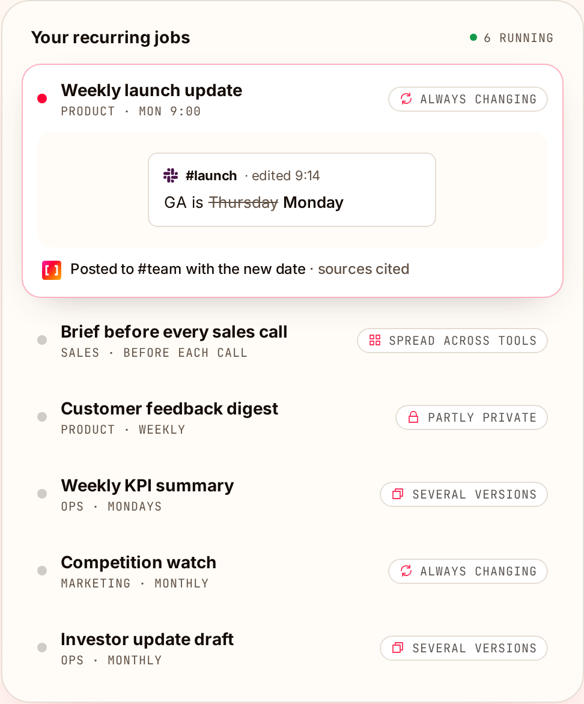

# Pomegranate

Pomegranate is a team's shared memory for AI. It turns the documents, notes,
transcripts and chats a team adds into a vault of short, current statements
(decisions, goals, status, positioning, voice), then answers questions and
reviews drafts **with citations back to the notes it relied on**. Any AI
assistant that speaks MCP (Claude, ChatGPT, Cursor, Claude Code…) can read
from it and write to it.

- **Capture.** Upload a file, paste text, connect an app, or message the
  Slack / WhatsApp bot. Each source is routed to the folder it belongs to and
  turned into notes. The newest statement on a topic wins; older ones stay
  readable.
- **Ask.** Get an answer drawn only from the vault, with node-id citations,
  or "I don't know".
- **Review.** Check a draft against what the team already decided and get
  red / yellow / green findings, each citing the note it conflicts with or
  supports.
- **Agents.** Get-updates subscriptions, draft / synthesize / catch-up /
  follow-up agents over your own notes, and data-agent templates that file
  typed entries (to-dos, decisions, people, specs…).

<p align="center">
  
</p>

## Why Pomegranate

We built Pomegranate on one belief: for people to trust AI with a complex
task, they need to see what it's looking at while it works, down to which
file it's reading and which email it's pulling a fact from. So every answer
and finding here comes with its sources.

We're open-sourcing it because agentic transformation is still early. We want
more teams to index their knowledge, share it and work with agents on top of
it, and we want people to build and control their own agents rather than be
replaced by products running them. The full stack is in this repo; it runs on
plain Node and SQLite, with no cloud lock-in and your choice of LLM provider.

Learn more:

- [Why Pomegranate](docs/why-pomegranate.md): the belief behind it, and why it's open source.
- [How it works](docs/how-it-works.md): add input any time, and the next run uses it.
- [Use cases](docs/use-cases.md): recurring jobs with messy inputs, and how to set one up.

## What's in this repository

This repository holds the server, the web app and the two chat bots.

| Path | What it is | Stack |
|---|---|---|
| `app/server` | API, MCP server, capture / query / review pipeline | Node 22, TypeScript, Hono, SQLite (`better-sqlite3`) |
| `app/web` | Web app | React, Vite, Tailwind |
| `surfaces/slack` | Slack bot (socket mode) | TypeScript, Bolt |
| `surfaces/whatsapp` | WhatsApp bot (via WasenderAPI webhooks) | TypeScript |
| `docs/` | Why, how it works, use cases, engineering conventions | Markdown |

## Quick start (local)

Requirements: Node 22 and an API key for one LLM provider.

```bash
# 1. Server
cd app/server
npm ci
cp .env.example .env         # set POMEGRANATE_LLM_PROVIDER and its key
npm run create-admin -- --email you@example.com
npm run dev:p1               # API on http://localhost:3000

# 2. Web app (second terminal)
cd app/web
npm ci
npm run dev                  # http://localhost:5173, proxies /api to :3000
```

Open http://localhost:5173 and sign in with the email and the temporary
password `create-admin` printed. You'll be asked to choose your own password,
then to create your first directory.

### Choosing an LLM provider

Every model call goes through one seam (`callStructured` in
`app/server/src/lib/anthropic.ts`), so switching providers is configuration
only:

| `POMEGRANATE_LLM_PROVIDER` | Needs |
|---|---|
| `anthropic` | `ANTHROPIC_API_KEY` |
| `together` (default) | `POMEGRANATE_HOSTED_API_KEY`, `POMEGRANATE_HOSTED_BASE_URL`, `POMEGRANATE_HOSTED_MODEL` |
| `hosted` | Same as `together`, for any OpenAI-compatible endpoint, including a model you host yourself |

An unknown provider name stops the server at boot, as does a missing key for
`together` / `hosted`. Embeddings use `OPENAI_API_KEY` when set; without it a
deterministic stub embedder is used and near-duplicate detection is weaker.

Anthropic is optional: Pomegranate has been running and tested on Qwen 9B,
both on Together AI and locally. See [docs/providers.md](docs/providers.md) for
what each provider does and how to run on low-cost models.

## Sign-up is closed by default

A fresh server is invite-only. `SIGNUP_MODE` is unset, which means `closed`:
only accounts that already exist can sign in. Anyone else who requests a
sign-in link is told there is no account for that email, plus who to ask if
you set `CONTACT_EMAIL`.

Create the first administrator from `app/server`:

```bash
npm run create-admin -- --email you@example.com
```

It prints a one-time temporary password. Running it again for an existing
email promotes that account to administrator and issues a new temporary
password. From there, administrators add people and directory owners invite
members under **Setup → Team & access** in the web app.

To let anyone with an email address create an account (fine on a laptop,
risky on the internet), set:

```bash
SIGNUP_MODE=open
```

### Mail

Sign-in links, invitations and password resets are sent with Resend
(`RESEND_API_KEY` + `MAIL_FROM`) or any SMTP server (`SMTP_URL`). With
neither set, the server never puts a sign-in code in an API response:
it writes the link to the server log (`auth.magic_link_unsent`), where only
the operator can read it. Password sign-in works without mail.

`POMEGRANATE_DEV_INLINE_CODES=1` returns codes in API responses instead. The
test suites use it. Never set it on a server other people can reach.

## Running in production

`npm run build` in each package, then:

- **Server:** `cd app/server && npm start` (listens on `PORT`, default 3000).
  The database and uploaded files live under `./data` unless you set
  `POMEGRANATE_DB_PATH` and `POMEGRANATE_FILES_DIR`. Schema migrations are
  additive and run on every start.
- **Web app:** the static files in `app/web/dist`.

Put both behind one HTTPS reverse proxy. The web app calls the server at
`/api`, so the proxy strips that prefix. MCP, OAuth discovery and the bot
relay are served by the server at the root. Set `PUBLIC_ORIGIN` and
`PUBLIC_APP_URL` to your public URL. For example, with Caddy:

```caddyfile
pomegranate.example.com {
	header {
		Content-Security-Policy "default-src 'self'; script-src 'self'; style-src 'self' 'unsafe-inline'; img-src 'self' data: blob: https:; connect-src 'self'; object-src 'none'; base-uri 'self'; frame-ancestors 'none'"
		X-Content-Type-Options "nosniff"
		Referrer-Policy "strict-origin-when-cross-origin"
	}
	handle_path /api/* {
		reverse_proxy localhost:3000
	}
	@server path /mcp/* /agent/* /.well-known/oauth-*
	handle @server {
		reverse_proxy localhost:3000
	}
	handle_path /whatsapp/* {
		reverse_proxy localhost:3002   # only if you run the WhatsApp bot
	}
	handle {
		root * /srv/pomegranate/app/web/dist
		try_files {path} /index.html
		file_server
	}
}
```

Behind a reverse proxy, also set `POMEGRANATE_TRUSTED_PROXY_HOPS=1` (one per
proxy in front of the server), so rate limits and audit logs record the real
client address. Without it the server ignores `X-Forwarded-For`, because
clients can set that header to anything.

Every variable the server reads is listed, with its default, in
`app/server/.env.example`.

## Connecting an AI assistant

Each directory has an MCP endpoint at `https://<your-domain>/mcp/server`.
Under **Setup → Integrations** you can:

- connect Claude or ChatGPT with OAuth,
- create a one-click claude.ai connector URL, or
- issue a connection token for Claude Desktop, Claude Code, Cursor or any
  other MCP client.

## Slack and WhatsApp bots

Both bots are separate processes that talk to the server over HTTP. Set the
same `SURFACE_AGENT_SECRET` on the server and on the bot.

- **Slack:** create a Slack app with socket mode, then
  `cd surfaces/slack && cp .env.example .env && npm ci && npm run build && npm start`.
  Design notes are in `surfaces/slack/docs/`.
- **WhatsApp:** see `surfaces/whatsapp/README.md`.

People link their Slack handle and WhatsApp number to their account in
**Your profile** under **Setup → General** in the web app.

## Development

```bash
cd app/server
npm run test:run                    # full suite (no API key needed: it runs on stubs)
npx vitest run src/lib/diff.test.ts # one file
npm run build                       # tsc + prompt assets into dist/

cd app/web
npm run build                       # typecheck + bundle
npm run test:e2e                    # Playwright

cd surfaces/slack && npm test       # same for surfaces/whatsapp
```

Things to know before changing the pipeline:

- **Workspace isolation is enforced in the application layer.** Every table
  is keyed by `workspace_id` and every query carries it. Cross-tenant
  "tripwire" tests guard this; keep them green.
- **Prompts live in `app/server/src/lib/prompts/<task>.md`**, one file per
  task with YAML frontmatter, and every model call returns structured output
  validated by a Zod schema. See [`docs/llm-calls.md`](docs/llm-calls.md).
- **Migrations are additive and idempotent.** Add columns with
  `addColumnIfMissing`; never write a destructive migration.

## Contributing

See [CONTRIBUTING.md](CONTRIBUTING.md). To report a security issue, see
[SECURITY.md](SECURITY.md).

## License

[MIT](LICENSE)
