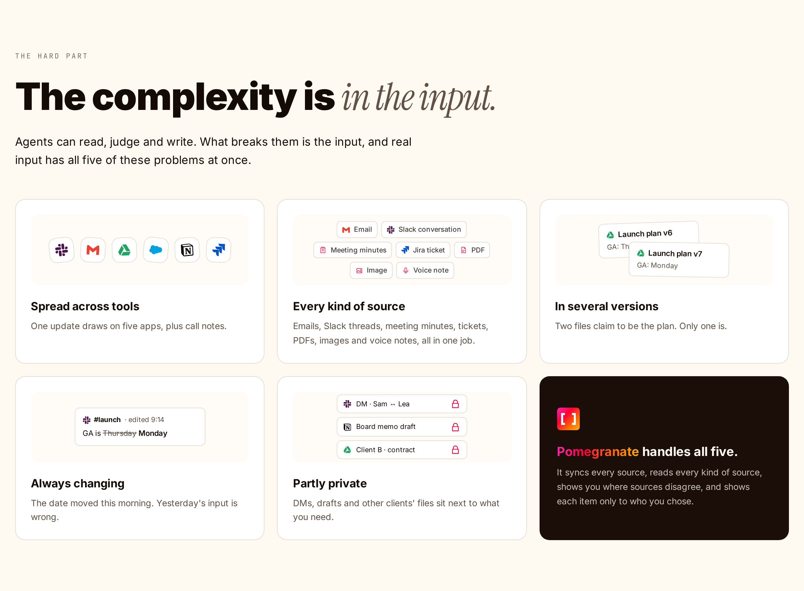
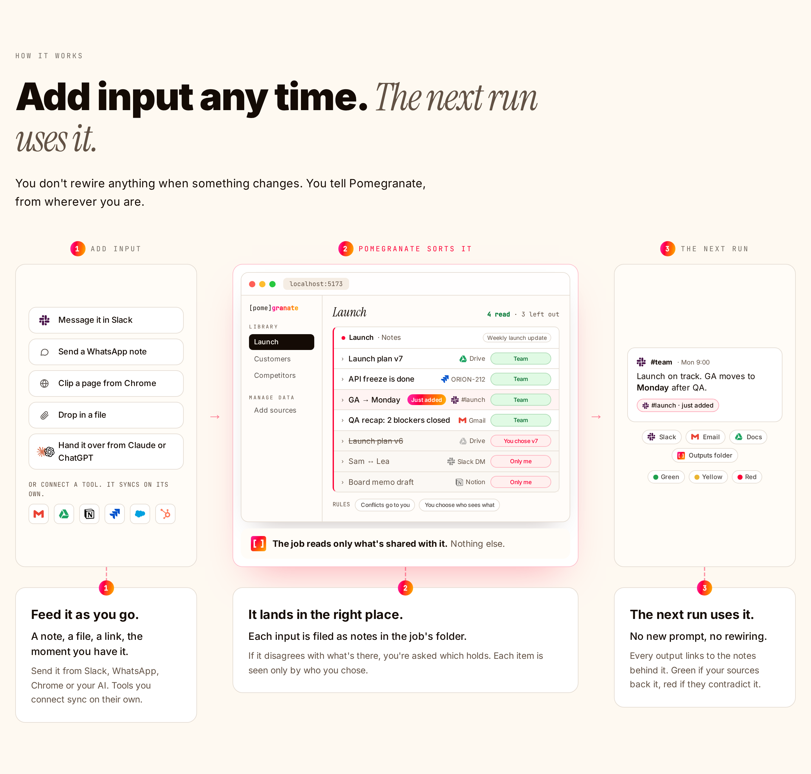

# How Pomegranate works

## The complexity is in the input



Agents can read, judge and write. What breaks a recurring job is its input,
and real input has five problems at once:

| Problem | Example | What Pomegranate does |
|---|---|---|
| **Spread across tools** | One update draws on five apps, plus call notes. | Connected apps sync into the same folders as everything else, so a job reads one place. |
| **Every kind of source** | Emails, Slack threads, meeting minutes, tickets, PDFs, images, voice notes. | Each source is read by its own extractor (Office files, PDF, HTML, images, audio) and turned into short notes. |
| **In several versions** | Two files claim to be the plan. Only one is. | The newest statement on a topic supersedes the older one, which stays readable with a link to what replaced it. |
| **Always changing** | The date moved this morning. Yesterday's input is wrong. | New input is applied as soon as it arrives, so the next run reads what is true now. |
| **Partly private** | DMs, drafts and other clients' files sit next to what you need. | Every note has an audience: *team*, *private* (you and your own AI) or *only me*. A job reads only what is shared with it. |

## Add input any time. The next run uses it.



### 1. Add input

Send a note, a file or a link the moment you have it:

- from **any MCP client** (Claude, ChatGPT, Cursor, Claude Code) with the
  `ingest_document` tool,
- from the **Slack** or **WhatsApp** bot (`surfaces/`),
- from the **web app**: upload a file or paste text,
- or connect an app (Gmail, Google Drive, Slack, Notion, GitHub, Jira,
  Microsoft Teams, Fathom) through Composio and pull from it, by hand or on a
  schedule.

The Chrome extension shown in the illustration is not part of this
repository; any of the routes above does the same job.

### 2. Pomegranate sorts it

Each source is routed to the folder it belongs to, using each folder's
description and template. When nothing fits, or the router wants to create a
new folder, the document is held and you decide where it goes. Nothing is
silently dropped.

Inside the folder, the source becomes notes shaped by the folder's template
(a decision log, a to-do list, people, specs, a status report…). The newest
statement on a topic wins; the one it replaces stays readable. Each note keeps
a link to the source it came from, and its audience decides who and which
agents can read it.

### 3. The next run uses it

Nothing to rewire: a recurring job reads its folders fresh every time.

- **Ask** answers from the vault only, citing the node ids it used, or says
  "I don't know".
- **Review** checks a draft against what holds and returns red / yellow /
  green findings, each citing the note it conflicts with or supports.
- **Get updates** watches a topic in plain language and sends a short, cited
  update by email or Slack on a schedule (`UPDATES_SCHEDULER=1`).
- **Work agents** (draft, synthesize, catch up, follow up) produce a piece of
  work from your own notes, with citations.
- **Automations** pull from connected apps on a schedule
  (`AUTOMATIONS_SCHEDULER=1`) so the input stays current without anyone
  remembering to add it.

## Under the hood

```
 Slack · WhatsApp · MCP clients · web app · connected apps
                        │
                        ▼
   extract ─▶ route to folder ─▶ capture notes (folder template)
                        │                      │
                        │        newest wins, older stays readable
                        ▼                      ▼
         workspace (directory) ─▶ folders ─▶ notes ── links ──▶ sources
                        │
                        ▼
   ask · review · get updates · work agents · automations   (every output cites notes)
```

- **One server** (`app/server`): Hono on Node, SQLite, files on disk and an
  in-process job queue. No cloud services are required.
- **One LLM seam:** every model call goes through `callStructured` and is
  validated against a Zod schema. Anthropic, Together AI or any
  OpenAI-compatible endpoint, chosen by configuration. See
  [llm-calls.md](llm-calls.md).
- **Isolation:** every table is keyed by workspace and every query carries
  it, with cross-tenant tests guarding the boundary. Encryption at rest is
  available (`POMEGRANATE_SEAL=1`).
- **Prompts as files:** each task's prompt lives in
  `app/server/src/lib/prompts/<task>.md`, versioned, so you can read and
  change exactly what the model is told.

Next: [Use cases](use-cases.md) · [Why Pomegranate](why-pomegranate.md)
