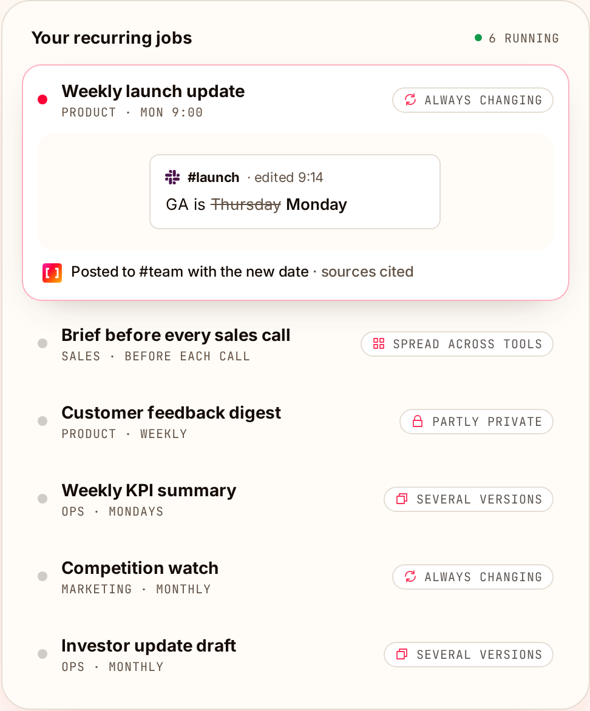
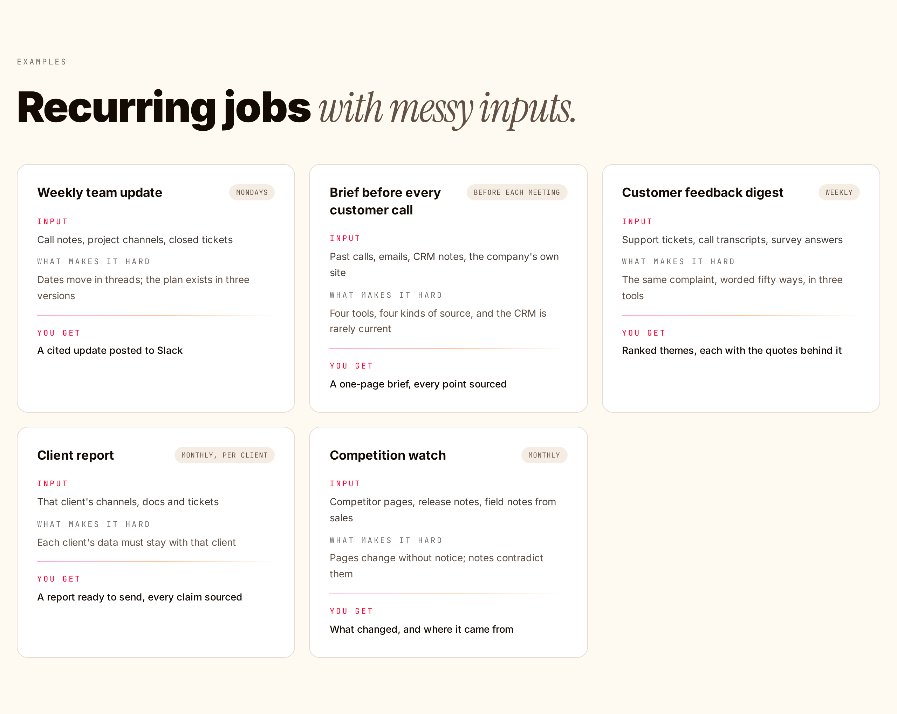

# Use cases

Pomegranate is built for **recurring jobs with messy inputs**: work that has
to happen every week, or before every meeting, where the hard part is
gathering what is current and true from many places.

## Examples

| Job | When | Input | What makes it hard | You get |
|---|---|---|---|---|
| **Weekly team update** | Mondays | Call notes, project channels, closed tickets | Dates move in threads; the plan exists in three versions | A cited update posted to Slack |
| **Brief before every customer call** | Before each meeting | Past calls, emails, CRM notes, the company's own site | Four tools, four kinds of source, and the CRM is rarely current | A one-page brief, every point sourced |
| **Customer feedback digest** | Weekly | Support tickets, call transcripts, survey answers | The same complaint, worded fifty ways, in three tools | Ranked themes, each with the quotes behind it |
| **Client report** | Monthly, per client | That client's channels, docs and tickets | Each client's data must stay with that client | A report ready to send, every claim sourced |
| **Competition watch** | Monthly | Competitor pages, release notes, field notes from sales | Pages change without notice; notes contradict them | What changed, and where it came from |

Other jobs teams run the same way: release notes from closed tickets, a
weekly KPI summary, pipeline review before a forecast, a weekly launch update,
a new-hire onboarding pack, an investor update draft.

## Setting one up

Every job follows the same pattern:

1. **Make a folder for its input.** Create a directory for the team, then a
   folder per job (Setup, or the `create_subfolder` MCP tool). Pick a template
   that fits the input (decision log, project status, people, evidence log,
   to-do list…) and describe in a sentence what belongs there. The router uses
   that description to file new sources.
2. **Feed it.** Point the people involved at the folder: they add notes from
   Slack, WhatsApp, their AI assistant or the web app. Connect the apps the
   job draws on and add an automation that pulls from them on a schedule.
3. **Decide who sees what.** Share notes with the team, keep them private to
   you and your own AI, or keep them to yourself only. A job reads only what
   is shared with it, so a client report never picks up another client's
   files.
4. **Run the job.** Subscribe to a topic with **Get updates** for a
   scheduled, cited summary by email or Slack. Or ask your assistant to draft
   the output from the folder over MCP (`get_context`, `query_context`), and
   check the draft with `review_deliverable` before it goes out.

When something changes, nobody edits the job. Someone adds the new fact, and
the next run uses it.

## For your own work

The same pieces work for one person. Keep a private directory, send yourself
notes from wherever you are, and use the work agents (draft, synthesize, catch
up, follow up) on your own material instead of rebuilding context in every
chat.

Next: [How it works](how-it-works.md) · [Why Pomegranate](why-pomegranate.md)
