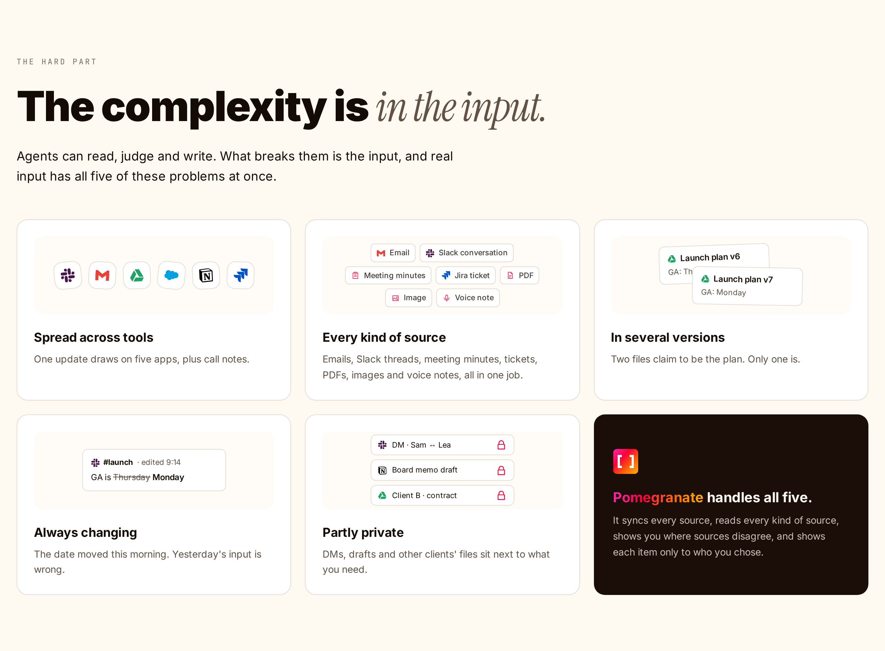

# Why Pomegranate

## What it is

Pomegranate is an AI brain for teams: a shared memory that agents can read,
write and act on. It holds what a team cares to track (decisions, goals,
status, positioning, voice) and runs the complex work that depends on it,
such as pipeline reviews, backlog reviews, experimentation planning and
product improvement planning.

You feed it the material your team already produces: documents, meeting
transcripts, notes, Slack and WhatsApp messages, connected apps. Pomegranate
files each source into the folder it belongs to and turns it into short,
current statements. When something changes, the newest statement wins and the
older one stays readable, so the brain reflects what is true today, with its
history intact.

Any assistant that speaks MCP (Claude, ChatGPT, Cursor, Claude Code) can work
from it. So can the web app and the Slack and WhatsApp bots.

The jobs it is built for are the ones teams never managed to automate. Agents
can read, judge and write; what breaks them is the input, which is spread
across tools, in every kind of source, in several versions, always changing
and partly private. Pomegranate exists to handle that input, so the job on
top of it can run every week.

## The belief it started from

For people to trust AI with a complex task, they need to see what it is
looking at while it works: which file it is reading, which email it is
pulling a fact from.

That belief shapes the whole system:

- Every answer, review finding and agent output **cites the notes it relied
  on**, and every note points back to the source it came from.
- When the brain doesn't know, it says "I don't know" instead of guessing.
- Reviews of a draft come back as red / yellow / green findings, each tied to
  the decision or rule it conflicts with or supports.
- Each model call is logged (who asked, what task, which prompt version, what
  came back) without storing the prompt or the user's verbatim text.

## What we learned

We onboarded teams who now use Pomegranate every day, as much as they use
Claude. Talking with many more people taught us two things:

- **Most professionals don't use an AI brain yet,** or don't see the value of
  one. Their work hasn't changed much in years. They still get what they need
  from meetings, reports and threads with colleagues.
- **Most of those who do use one don't automate much with it.** They use it as
  a knowledge base, not as something agents act on.

Agentic transformation is still early, and nobody knows yet how it will play
out.

## Why open source

We're open-sourcing Pomegranate to help that transformation along. We want
more teams to index their knowledge, share it and work with agents on top of
it.

We don't want a future where people are replaced by products running agents.
We want one where people build and control their own agents. That means the
brain has to be something a team can run, read and change itself:

- **The full stack is here:** the API and MCP server, the capture, query and
  review pipeline, the web app, and the Slack and WhatsApp bots.
- **No cloud lock-in:** it runs on plain Node and SQLite, with files on disk
  and an in-process job queue.
- **Your choice of model:** Anthropic, Together AI, or any OpenAI-compatible
  endpoint, including a model you host yourself. Switching is configuration
  only.
- **Your data stays yours:** workspaces are isolated from each other, and
  encryption at rest can be switched on (`POMEGRANATE_SEAL=1` with a key).

Start with the [README](../README.md) to run it, or read
[How it works](how-it-works.md) and the [use cases](use-cases.md).

## Thanks

Thank you to Henriette Cramer for building the foundations of Pomegranate,
and to our customers and the many people who shared their perspectives,
supported us and made introductions.
